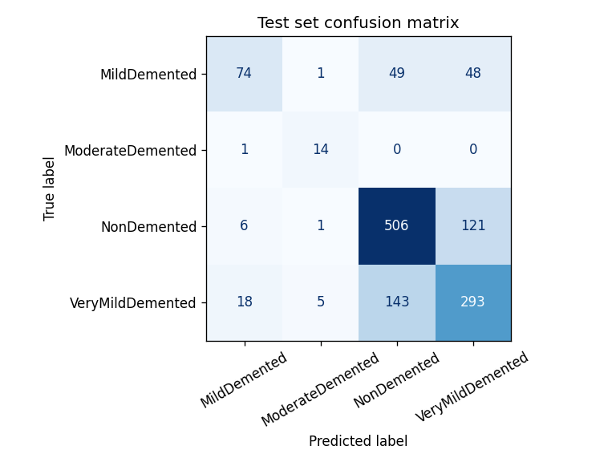
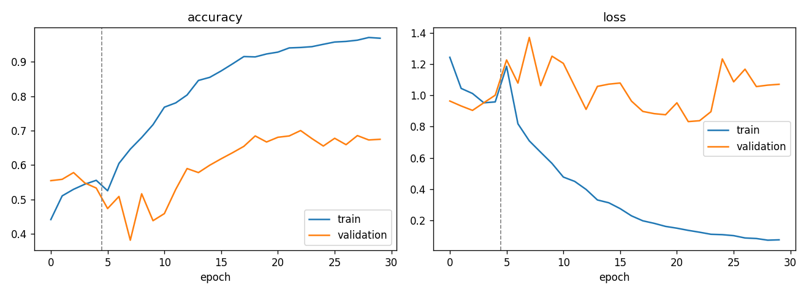

# Alzheimer's MRI Classifier

A convolutional neural network that classifies axial brain MRI slices into four dementia stages, served through a Flask web app.

**Live demo:** https://alzheimers-detection-9lcj.onrender.com
(free hosting, so the first load after a quiet period can take about 30 seconds)

> **Research and portfolio project only.** This is not a medical device. It has not been clinically validated and must not be used for diagnosis.

## How it works

1. **Training** ([`notebooks/train_model.ipynb`](notebooks/train_model.ipynb), run on a Colab T4 GPU). Uses transfer learning from MobileNetV2 pretrained on ImageNet. Stage 1 trains a new classification head. Stage 2 unfreezes the whole backbone, including BatchNorm statistics, since MRI slices differ a lot from ImageNet photos. Training uses square-root-softened class weights for the imbalanced classes, light augmentation (rotation, zoom, translation) and early stopping on validation loss.
2. **Export.** The trained model is converted to TensorFlow Lite with float16 weights (4.5 MB), so it runs on a small CPU server. On a 64-image check, the TFLite model agreed with the Keras model on 63.
3. **Serving** ([`app.py`](app.py)). A Flask API resizes the uploaded image to 128×128 and runs the TFLite model. It returns the predicted class, the probability for every class, and the inference time. If the model file is missing, the API returns an error and never guesses.

## Results

Evaluated once on the dataset's held-out test split, which is never used for training or model selection. Full numbers are in [`artifacts/metrics.json`](artifacts/metrics.json).

**Test accuracy: 69.3%** · **Macro F1: 0.680** · Majority-class baseline: 49.5% (1,280 test images)

| Class | Precision | Recall | F1 | Test images |
|---|---|---|---|---|
| MildDemented | 0.747 | 0.430 | 0.546 | 172 |
| ModerateDemented | 0.667 | 0.933 | 0.778 | 15 |
| NonDemented | 0.725 | 0.798 | 0.760 | 634 |
| VeryMildDemented | 0.634 | 0.638 | 0.636 | 459 |

The model clearly beats the baseline, but it is far from clinical quality. It confuses neighbouring stages most, especially MildDemented with VeryMildDemented. Training accuracy reached about 95% while validation plateaued near 70%, so the main limit is generalisation. More data or stronger regularisation would be the next steps.

**Earlier experiments, kept for transparency.** With the backbone frozen apart from its top layers, test accuracy was 51.8%, barely above the baseline. With full fine-tuning but BatchNorm frozen at its ImageNet statistics, it was 63.9%. Letting BatchNorm adapt gave the result above.




### Limitations

- **Possible data leakage.** The dataset has no patient IDs, and slices from the same person can appear in both the training and test sets. This tends to inflate test scores, so the figures above are an upper bound. A proper evaluation would split the data by patient, for example using OASIS with its subject IDs.
- **Single source.** All images come from one public dataset. Performance on scans from other hospitals, scanners or protocols is unknown.
- **Severe class imbalance.** ModerateDemented has very few examples, so its per-class scores are the least reliable.

## Dataset

[Falah/Alzheimer_MRI](https://huggingface.co/datasets/Falah/Alzheimer_MRI) on Hugging Face: 6,400 axial MRI slices at 128×128, labelled MildDemented, ModerateDemented, NonDemented and VeryMildDemented, with a fixed train/test split (5,120 / 1,280). A stratified 20% of the training split is used for validation. The notebook downloads the data, which needs no login; it is not stored in this repo.

## API

`POST /predict` takes a multipart form with an `image` field (PNG or JPEG, up to 5 MB).

```json
{
  "prediction": "NonDemented",
  "confidence": 0.8132,
  "probabilities": {"MildDemented": 0.061, "ModerateDemented": 0.004, "NonDemented": 0.8132, "VeryMildDemented": 0.1218},
  "inference_ms": 142.7,
  "disclaimer": "Research demo only. Not a medical device and not for clinical decisions."
}
```

`GET /health` returns `200` when the model is loaded and `503` when it is not. Render uses it as a health check.

## Run locally

```bash
git clone https://github.com/tejasgahallot026/alzheimers-detection.git
cd alzheimers-detection
python -m venv .venv && source .venv/bin/activate   # Windows: .venv\Scripts\activate
pip install -r requirements-dev.txt
python app.py                                       # http://localhost:5000
pytest -v                                           # API tests, no model needed
```

The app expects `artifacts/model.tflite` and `artifacts/labels.json`. Both are produced by the training notebook.

## Project structure

```
app.py                     Flask app: preprocessing, TFLite inference, API routes
templates/index.html       Upload page
notebooks/train_model.ipynb  Training, evaluation and export (Colab)
artifacts/                 model.tflite, labels.json, metrics.json, confusion_matrix.png, training_curves.png
tests/test_app.py          API tests using a stand-in model
requirements.txt           Runtime dependencies (uses ai-edge-litert, not full TensorFlow)
Procfile, render.yaml      Deployment on Render
```

## Tech stack

Python, TensorFlow/Keras (training), TensorFlow Lite via ai-edge-litert (serving), Flask, Gunicorn, NumPy, Pillow, scikit-learn, pytest, Render.

## Possible next steps

- Retrain and evaluate on a dataset with patient IDs, to get a leakage-free estimate.
- Add Grad-CAM heatmaps so users can see which regions drove a prediction.
- Add CI that runs the tests on every push.
